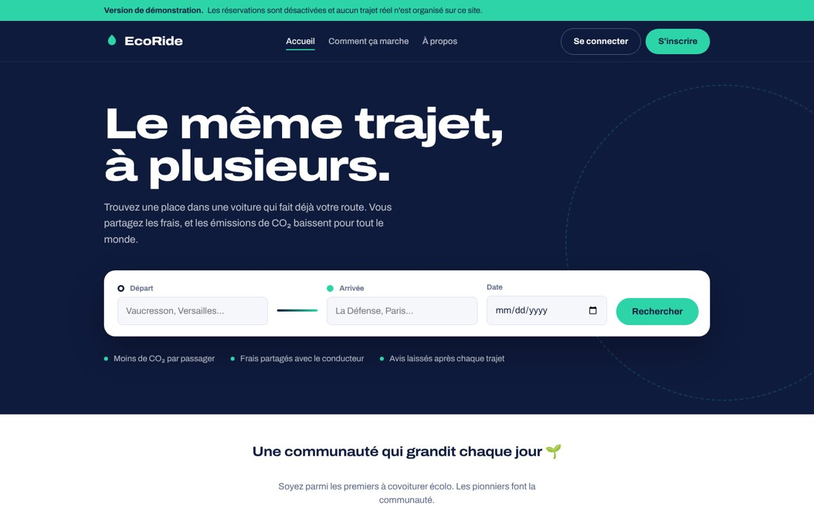
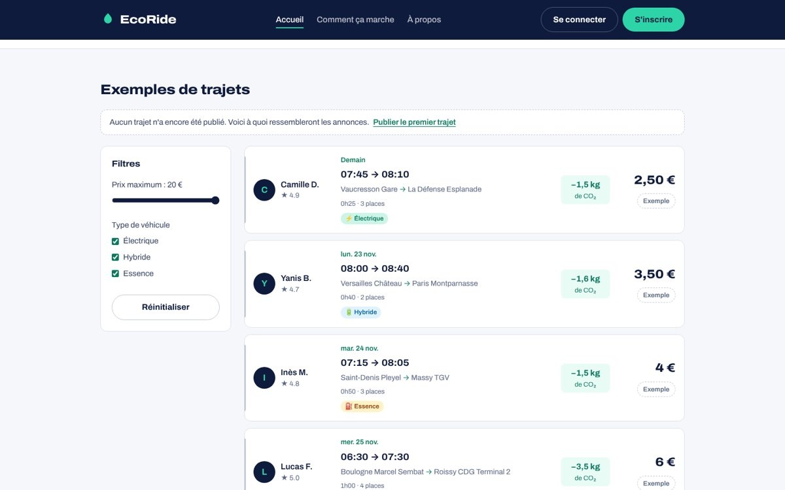

# EcoRide — Covoiturage du quotidien

> Plateforme fullstack de covoiturage pour les trajets courts en Île-de-France
> (domicile-travail, gare, aéroport). Entièrement codée à la main en PHP / SQLite,
> sans framework.

🔗 **Démo en ligne** : [https://moussa.alwaysdata.net](https://moussa.alwaysdata.net) — version de démonstration (réservations désactivées)




---

## ✨ Fonctionnalités

- 🔍 **Recherche server-side** (URL partageable type `?depart=Paris&arrivee=Lyon&date=...`)
- 🚗 **CRUD complet** sur les trajets (publier, modifier, supprimer)
- 🎟️ **Réservations** avec transactions SQL atomiques (gestion des places dispo + condition de course)
- 💬 **Messagerie** entre passagers et conducteurs avec badge de notifications non lues
- ⭐ **Système d'avis** (note 1-5 + commentaire) après les trajets passés, avec calcul de note moyenne via `AVG()`
- 👥 **3 rôles utilisateurs** (passager / conducteur / admin) avec promotion explicite
- 👑 **Dashboard admin** avec stats agrégées (`COUNT`, `SUM`, `AVG`) et modération
- 📊 **Stats publiques** sur l'accueil avec **seuil intelligent** (preuve sociale chiffrée si plateforme mature, message qualitatif sinon)
- 📱 **Responsive complet** avec menu burger mobile
- 🗺️ **Trajets courts en Île-de-France** : prix au centime, suggestions de 67 villes, CO₂ estimé selon la durée et le véhicule
- 🔑 **Mot de passe oublié** par e-mail (jeton aléatoire haché, valable 1 h, usage unique) et **limite de 5 tentatives** de connexion
- ✉️ **Envoi d'e-mails par SMTP** avec page admin de diagnostic
- 💶 **Frais de service** de 15 % (minimum 0,30 €) affichés avant la réservation
- 🧪 **Mode démonstration** activable : bandeau sur toutes les pages, réservations bloquées côté serveur
- ⚖️ **Pages légales** : CGU, politique de confidentialité RGPD, mentions légales, consentement à l'inscription
- 🔎 **SEO** : balise canonical, image Open Graph, données structurées, sitemap



## 🏗️ Architecture

```
EcoRide/
├── index.php, trajet.php, publier.php...    # Pages publiques + protégées
├── admin.php, debug.php                     # Pages admin
├── lib/
│   ├── init.php          # Bootstrap (sessions, env detection)
│   ├── db.php            # PDO + migrations idempotentes
│   ├── auth.php          # Auth + rôles (passager/conducteur/admin)
│   ├── trajets.php       # CRUD trajets + recherche
│   ├── reservations.php  # Réservations avec transactions SQL
│   ├── avis.php          # Système d'avis avec agrégats
│   ├── messages.php      # Messagerie avec CTE et JOIN
│   ├── admin.php         # Stats globales + actions admin
│   ├── csrf.php          # Protection CSRF (tokens + hash_equals)
│   ├── securite.php      # Limite de tentatives + réinitialisation du mot de passe
│   ├── mailer.php        # Client SMTP minimal (STARTTLS) + secours mail()
│   └── exemples.php      # Trajets d'exemple affichés quand aucun n'est publié
├── partials/
│   ├── header.php        # Header partagé (nav adaptative selon rôle)
│   └── footer.php        # Footer enrichi
├── api/
│   └── trajets.php       # Endpoint JSON
├── data/
│   ├── ecoride.sqlite    # BDD (créée auto au 1er run)
│   └── *.json            # Seed initial (importé une fois)
└── assets/css/, assets/js/
```

## 🔒 Sécurité

| Mesure | Implémentation |
|---|---|
| Mots de passe | `password_hash()` (bcrypt avec sel auto) + `password_verify()` |
| Sessions | `secure`, `httponly`, `samesite=Lax`, `session_regenerate_id` au login |
| Anti-injection SQL | Uniquement requêtes préparées PDO avec `:placeholders` |
| Anti-CSRF | Token aléatoire 64 hex en session, vérifié avec `hash_equals()` (anti-timing) |
| Defense in depth | Vérification user_id dans le `WHERE` SQL en plus du PHP |
| Atomicité | `beginTransaction()` / `commit()` / `rollBack()` sur les réservations |
| Listing dossiers | `Options -Indexes` dans `.htaccess` |
| Fichiers cachés | Bloqués via `<FilesMatch "^\.">` |
| BDD téléchargeable | Bloquée via `data/.htaccess` (`Require all denied`) |
| Logout | POST + CSRF (anti-déconnexion forcée par lien) |
| HTTPS | Let's Encrypt automatique (AlwaysData) |
| En-têtes HTTP | HSTS, Content-Security-Policy, X-Frame-Options, nosniff, Referrer-Policy |
| Force brute | Blocage 15 min après 5 échecs (e-mail ou IP hachée) |
| Réinitialisation | Jeton `random_bytes`, seul son hash SHA-256 est stocké, expiration 1 h |
| RGPD | Police auto-hébergée (aucun appel à Google), un seul cookie de session |

## 🛠️ Stack technique

- **Backend** : PHP 8.2+ (procédural, pas de framework)
- **Base de données** : SQLite via PDO
- **Frontend** : HTML / CSS / JS vanilla (zéro framework, zéro npm)
- **Serveur web** : Apache 2.4 (avec `.htaccess` pour la config)
- **Hébergement** : AlwaysData (gratuit) avec HTTPS via Let's Encrypt
- **Dev local** : Laravel Herd

## 🚀 Installation locale

```bash
# 1. Cloner
git clone https://github.com/Moussa-data/covoiturage-ecoride.git
cd covoiturage-ecoride

# 2. Lancer le serveur PHP intégré
php -S localhost:8000

# 3. Ouvrir dans le navigateur
open http://localhost:8000
```

La BDD SQLite et le schéma sont créés **automatiquement** au premier accès (migrations idempotentes dans `lib/db.php`).

## 🌐 Déploiement

Voir [DEPLOY.md](./DEPLOY.md) pour le guide pas-à-pas du déploiement sur AlwaysData (gratuit).

## 📚 Concepts SQL/PHP démontrés

- **Migrations idempotentes** : `ALTER TABLE ... ADD COLUMN` avec vérification préalable via `PRAGMA table_info()`
- **JOINs multiples** : `INNER JOIN users ON ... INNER JOIN trajets ON ...`
- **Sous-requêtes corrélées** : pour compter les réservations par trajet
- **CTE (`WITH ... AS`)** : pour structurer les requêtes complexes de la messagerie
- **Agrégats** : `COUNT(*)`, `AVG(note)`, `SUM(co2_economise_kg)`
- **Foreign keys + CASCADE** : `ON DELETE CASCADE` pour la cohérence
- **Contraintes** : `UNIQUE(user_id, trajet_id)`, `CHECK (note BETWEEN 1 AND 5)`
- **Transactions** : pour les réservations atomiques

## 🎯 Choix techniques

Le projet évite volontairement les frameworks (Symfony, Laravel), l'ORM et les outils de build,
pour maîtriser chaque brique : routage, sessions, SQL, sécurité, e-mails. Le code est commenté
pour être lisible et facile à reprendre.

## 📜 Licence

Code source visible à titre de portfolio. Tous droits réservés.

---

Conçu et développé par **[Moussa Wane Camara](https://moussa-wanecamara.netlify.app)**, développeur web fullstack freelance.
